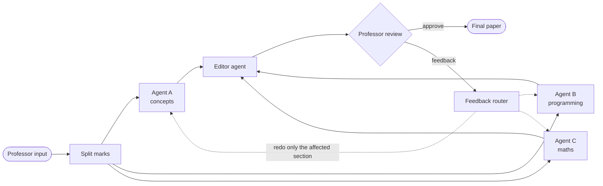

# AI Exam Paper Generator

A multi-agent system that drafts a full exam paper from a topic, a mark budget and a difficulty level, then waits for a professor to approve it or send it back with feedback.

## How it works



1. **Split marks.** The total marks are divided across three specialist agents according to the chosen distribution.
2. **Draft in parallel.** Each agent (Gemini 2.5 Flash) researches its topic with Tavily search and writes questions with answer keys, sized exactly to its mark budget.
3. **Edit.** An editor agent merges the three sections into one consistent paper.
4. **Human review.** The professor sees the draft and either approves it or writes feedback.
5. **Targeted redo.** A feedback-router agent reads the feedback and sends it only to the agent(s) whose section needs changing, so the rest of the paper is kept.

Every draft and every round of feedback is stored, so a professor can see how the paper evolved.

## Stack

Next.js 16 (App Router) · TypeScript · LangGraph · Gemini 2.5 Flash · Tavily · NextAuth · Prisma · SQLite · Framer Motion

## Run locally

```bash
git clone https://github.com/Rashi18032006/Exam_Paper-generator.git
cd Exam_Paper-generator
npm install
cp .env.example .env    # then fill in the keys
npx prisma db push      # creates the SQLite tables
npx tsx prisma/seed.ts  # creates a demo professor account
npm run dev
```

Open http://localhost:3000.

### Environment variables

| Variable | What it is |
|---|---|
| `GOOGLE_API_KEY` | Gemini API key (Google AI Studio) |
| `TAVILY_API_KEY` | Tavily search key |
| `NEXTAUTH_SECRET` | Any long random string (`openssl rand -base64 32`) |
| `NEXTAUTH_URL` | `http://localhost:3000` locally |
| `DATABASE_URL` | `file:./dev.db` for SQLite |

## Project layout

```
src/
  lib/agent/examGraph.ts   LangGraph workflow (agents, editor, router, review)
  lib/agent/tools.ts       Tavily search and mark splitting
  app/api/exam/            generate, approve, reject, details routes
  app/exam/                new-exam form and review screen
prisma/schema.prisma       User, ExamSession, ExamDraft
```

## What I learned

- Designing a LangGraph with parallel branches, a join and a conditional loop back.
- Keeping LLM output to a strict JSON shape, and fixing the marks when the model miscounts.
- Putting a human approval step inside an agent loop instead of after it.
